# BuhurtOS new-domain verification — 2026-10-30

Live site: https://buhurt-os.app. Observed footer: **d90be08**, built 2026-10-30 16:21 UTC. Edge Chromium, requested viewport 390×844; DOM measured innerWidth 390, innerHeight 844, document scrollWidth 375 on the duel desk. No horizontal overflow there. Touch emulation and a second isolated Edge context were unavailable through the connected browser tools. Do not treat this as a completed physical-phone rehearsal.

## Results

| Step | Result | Evidence / scope |
|---|---|---|
| 1 Redirects | PASS | www /events?x=1 landed at https://buhurt-os.app/events?x=1. No certificate warning. Old https://buhurt-os.vercel.app/events loaded the app. Native certificate/padlock details were not separately inspected. Screenshots 01–02. |
| 2 Email/password | PASS | Owner had no password account and explicitly authorized creating a dedicated Supabase test user. Created through hosted Auth dashboard, then signed out and signed into apex with its email/password. Account rendered on buhurt-os.app/account. No password printed or saved to report. Screenshot 25. |
| 3 Email code | PASS functionally; FAIL copy accuracy | Organizer received an **eight-digit** code although UI repeatedly promises six digits. The field accepted it and sign-in succeeded on apex. Email contained no link: **email link not checked — code-only email**. Email also says “create your account” for an existing user. Screenshots 09–10. |
| 4 Google | PASS on fresh retry; earlier outcome inconclusive | Google account chooser appeared with redirect_to=https://buhurt-os.app/account and no origin_mismatch or redirect_uri_mismatch. Initial user-completed return stayed signed out, including after revisiting Account. A fresh later attempt signed organizer in successfully on apex. Concurrent earlier OAuth attempts may have affected the first callback; not a reproducible product failure. Screenshots 08, 24. |
| 5 Test event | PASS | Test checkbox selected, review explicitly private/test, one Men Longsword competition, two organizer-added existing synthetic fighters. Event page shows Test data and staff-only note, scheduled cleanup November 10. Screenshot 16. |
| 6 Counter QR | PARTIAL / BLOCKED | QR creation succeeded, no captured warning/error. Decoded the rendered SVG locally: link starts exactly https://buhurt-os.app/device#c=. Secret suffix omitted. Connected Edge supports shared-session tabs only, not isolated contexts; did not substitute a shared tab and claim isolation. Device-session redemption and CORS response/status therefore **not tested**. |
| 7 Score/finalize | PARTIAL | Desk started/ended two rounds; automatic score dialogs opened. Confirmed 4–2 and 6–2, saved official **10–4 Man A**. Server-confirmed official screen passed. Counter “Head or torso, two hands +2” label and phone seeing end were **not tested** because step 6 is blocked. Screenshots 13–15. |
| 8 Public pages/privacy | PASS for sampled pages | Signed-out Red Deer Rumble 2026, Garrett Robson fighter, Red Deer Reavers team loaded with empty captured console warning/error arrays. New test event direct URL returned generic 404 signed out; all-dates event search found no match. New non-staff password account saw “Event not available.” This fixture remains a draft; published-private behavior was not retested here. Screenshots 03–05, 22–23, 26. |
| 9 Share/calendar | PASS | Share copied apex event URL. Google Calendar link has apex event URL in details; outer calendar.google.com destination is expected. Downloaded ICS URL and DESCRIPTION use apex. Download event listener timed out, but files actually downloaded and were read and verified. Screenshot 17 and exported ICS included. |
| 10 Install/push | PASS for manifest/subscription UI | Manifest loaded on apex with relative scope/start_url/shortcuts. Edge offered Install BuhurtOS. Owner accepted browser notification permission. Manage devices showed Allowed / On / THIS DEVICE; Send me a test returned “Test sent.” No claim of visually observed OS toast. Successful subscription is evidence of worker-backed push functioning, but service-worker registration was not separately inspected in DevTools. Screenshots 06, 20–21. |

## Preserved synthetic fixtures

- Event: **TEST New Domain Longsword Rehearsal 2026-10-30**
- URL: https://buhurt-os.app/events/test-new-domain-longsword-rehearsal-2026-10-30
- Event ID (calendar UID): 2ec7b079-9550-40dc-905d-fab3dc2ae5fa
- Match: b34f0238-35db-4697-836c-0101c3689517, Lyst 1. Official 10–4 to TEST Outrance Man A over TEST Outrance Man B. Two rounds, 4–2 and 6–2.
- Event remains draft, test checkbox enabled. App says cleanup November 10, 2026 after ten days; no cleanup executed.
- New password account: garrettrobson95+buhurt-domain-test-20261030@gmail.com. Created only after owner explicitly asked. Auto-confirmed via dashboard, no staff role or public fighter profile assigned. Alias reaches owner inbox. Random password was kept only in automation memory; not committed or saved in browser. Use the normal recovery flow if future access is needed.
- No real event, fighter, team or HACSA profile edited/deleted. Existing synthetic A/B profiles were entered in the new test competition without editing the profiles.
- No app code, auth configuration, schema or migrations changed. Notification subscription enabled as requested. No records deleted.

## Findings and proposed fixes (not implemented)

### F1 — P3: six-digit promise conflicts with eight-digit email

URL: https://buhurt-os.app/account. UI says “We email you a 6-digit code” and “We sent a 6-digit code”; delivered email has eight digits. Actual input pattern was [0-9 ]{6,8}, and eight-digit verification succeeded. The email tells an existing user to create an account. No console/network error accompanied this successful flow; HTTP statuses not captured.

Suggested change: describe the code without a fixed length and use sign-in wording in the email. Keep leading zeroes by treating the code as text; do not coerce it to a number. Illustrative UI code, to adapt to the existing component:

~~~tsx
const codeInstructions = 'Enter the sign-in code from your email.';

{codeInstructions}

<input
  aria-label="Code"
  inputMode="numeric"
  autoComplete="one-time-code"
  pattern="[0-9 ]{6,8}"
  value={code}
  onChange={(event) => setCode(event.target.value)}
/>
~~~

Suggested email text: “Your BuhurtOS sign-in code” and “Enter this code to sign in.” Regression: existing and new users, leading-zero codes, both supported lengths, invalid/expired codes. Do not change the hosted token length merely to match stale UI copy.

### O1 — initial Google callback did not establish a visible session; fresh retry passed

Observed URL: https://buhurt-os.app/account?code=[REDACTED]. First return showed Sign in, no visible explanation; captured console was empty. Second fresh attempt authenticated successfully. No request status was captured, and the first attempt overlapped another OAuth initiation, so root cause is unproven. Do not prescribe an unconditional extra exchange call: exchanging the same code twice or overwriting PKCE verifier state could itself break login.

Suggested diagnostic improvement if reproduced with one auth tab: explicitly show pending/callback failure states in the existing auth provider, and log only sanitized error code/status, never tokens or callback URLs. Illustrative display code (existing provider must resolve these props):

~~~tsx
function CallbackStatus({ pending, failed }: {
  pending: boolean; failed: boolean;
}) {
  if (pending) return 
Finishing sign-in…
;
  if (failed) return (
    
Sign-in could not finish. Please start sign-in again.

  );
  return null;
}
~~~

Reasoning: a callback should not silently resemble an untouched sign-in form. Verify one fresh Google attempt, reload after success, expired callback, canceled login and overlapping-tab behavior. Supabase documents that PKCE codes are single-use and require the originating verifier: https://supabase.com/docs/guides/auth/sessions/pkce-flow and https://supabase.com/docs/reference/javascript/auth-exchangecodeforsession.

### O2 — legacy test-data event visible in public fighter Upcoming

https://buhurt-os.app/fighters/7c848b31-39db-453c-b2c4-7fa84982620f showed “Red Deer Rumble-test” with TEST DATA while signed out. Its legacy classification may differ from the new private test_event flag. The newly created fixture was hidden. This is an investigation note, not proof that new private test events leak. If policy requires all legacy synthetic events hidden, apply the shared public-event authorization predicate before building Upcoming; do not hide only a client badge or infer privacy from names. Suggested logic contract:

~~~ts
const visibleUpcoming = upcoming.filter(row =>
  row.event.visibility === 'public' && row.event.isTest === false
);
~~~

The field names above are illustrative, not a reviewed schema patch. Enforce the same predicate server-side, and separately test staff visibility.

## Old-address audit and limitations

No old vercel.app or github.io link was found in the sampled apex pages, copied event link, calendar URLs, decoded Counter QR or manifest. This is not a whole-site crawl. When deliberately browsing the old Vercel host, its relative navigation stayed on that host, as expected for an address that must continue to work.

No device-session request was made in an isolated phone context, so no CORS response headers/status exist for this run. Console checks only cover captured entries, not a complete network trace. Native Windows screenshot/input mapping failed for the notification permission dialog; owner completed that control. Explicit clipped screenshots sometimes timed out; default screenshots succeeded and were visually checked. No fabricated screenshots or reconstructed UI images are included.

Remaining required verification: isolated counter context with touch, Longsword +2 pad, device-session/CORS, counter final screen. All records preserved for continuation.

## Screenshots

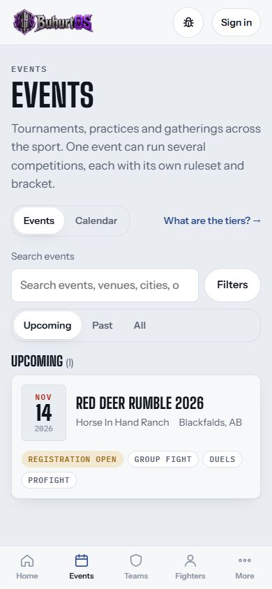

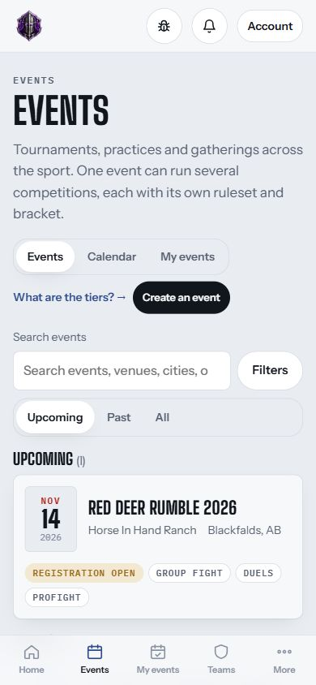

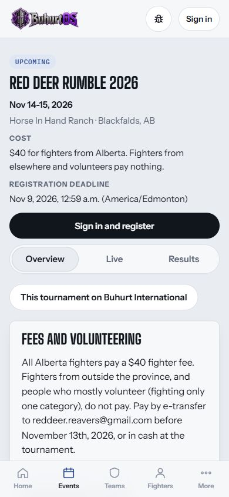

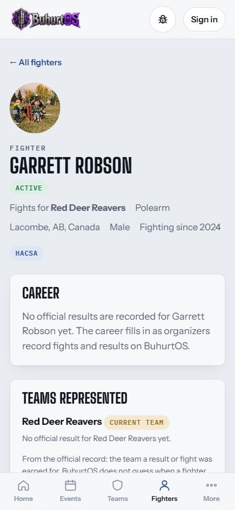

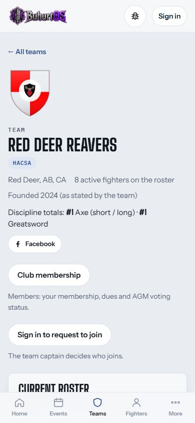

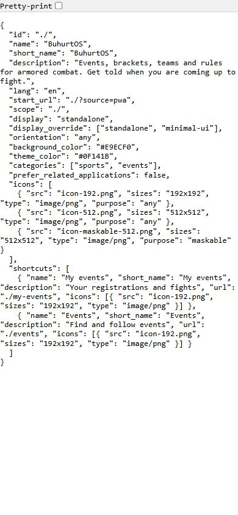

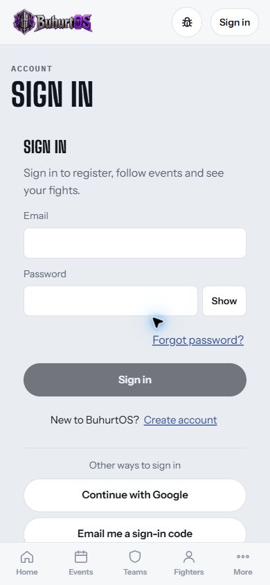

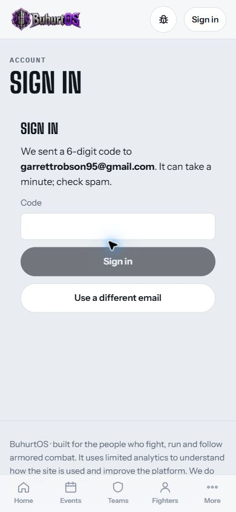

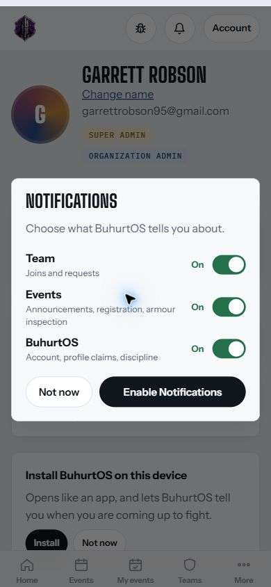

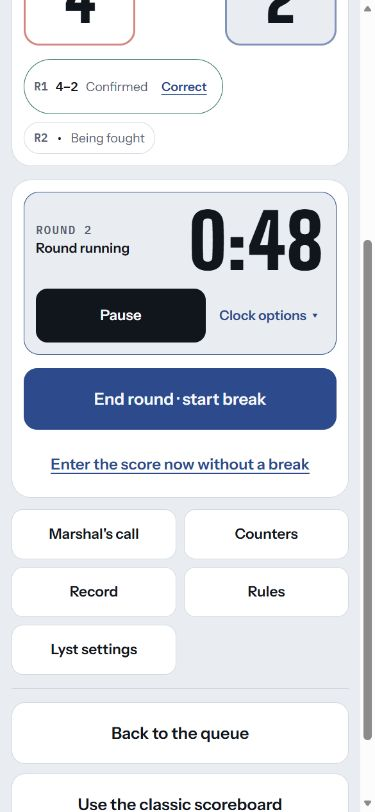

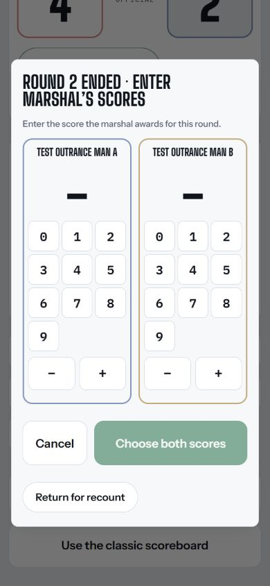

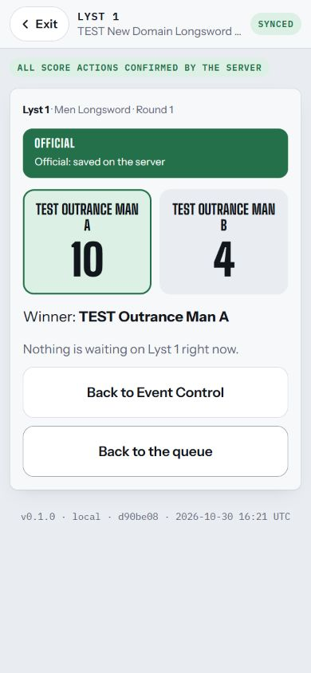

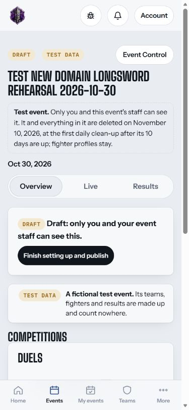

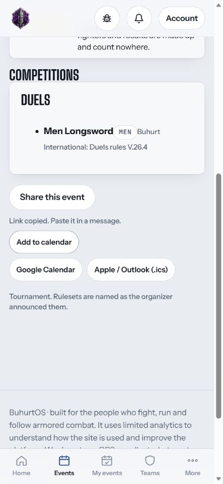

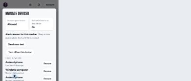

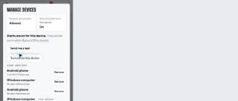

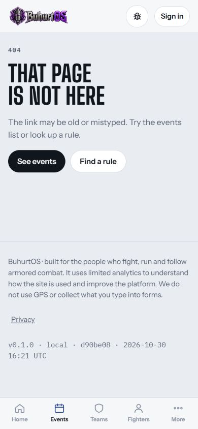

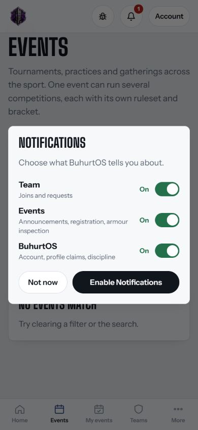

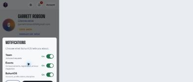

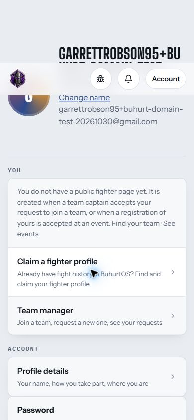

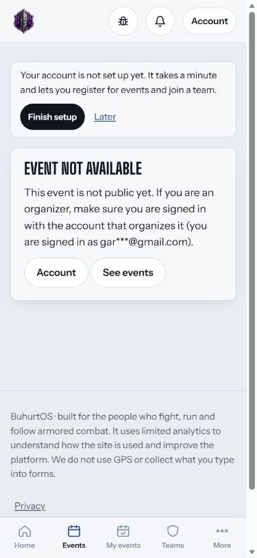

Evidence quality note: screenshots 20, 21 and 24 were returned as scaled captures by the browser tool. Treat the readable saved device-status text and recorded UI observations as their supporting evidence; these three images alone are not sufficient visual proof. Screenshot 25 was replaced with a readable 390×844 capture.
